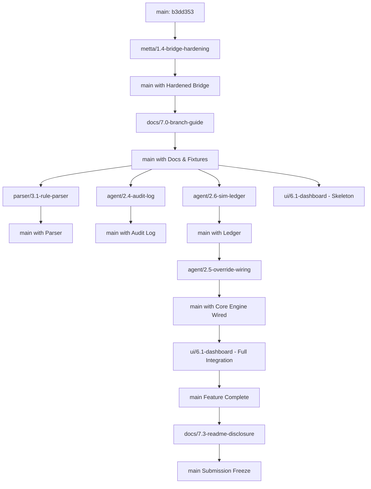

# Git Branching Strategy & Lifecycle Guide

This document defines the branch lifecycle, isolation rules, test procedures, and merge sequence for all workstreams on the Fractional Approval Agent project.

---

## 1. Branch Rules & Isolation Invariants

Per `AGENTS.md`:
- **Never commit directly to `main`:** Every change must live on an isolated task branch named `area/task-id-name` and reach `main` via a Pull Request.
- **Never force-push:** History is immutable.
- **Strict File Ownership:** A task branch must ONLY touch files within its assigned scope. Never modify or format files owned by other workstreams.
- **Commit Format:** `type(scope): summary [task-id]` followed by an `Assisted-by: <tool and model>` line for AI-assisted work.
- **Keep `PROGRESS.md` Updated:** Update `PROGRESS.md` after each task or sprint.
- **No Float Arithmetic:** All money values are strictly integer minor units (cents) and basis points (bps).

---

## 2. Master Branch Matrix

| Branch Name | Status | Base Branch | Owner | Focus Area |
| :--- | :--- | :--- | :--- | :--- |
| `main` | **Active / Mainline** | - | Team | Production trunk; protected branch. |
| `spike/metta-omega-integration` | **Merged** (PR #1) | `main` | Lead | Hyperon MeTTa adapter spike & Omega live container verification. |
| `data/0.3-synthetic-registry` | **Merged** | `main` | Lead | Synthetic artwork catalog, test oracle, scenarios SC-01 to SC-09. |
| `metta/1.3-settlement-rule` | **Merged** | `data/0.3-synthetic-registry` | Lead | Pure MeTTa settlement rules, direct assertion tests, Atom API bridge. |
| `metta/1.4-bridge-hardening` | **Active** | `main` | Lead | Bridge argument hardening (rejects parens, quotes, whitespace, nested expressions) and native Hyperon Atom API fact generation. |
| `docs/7.0-branch-guide` | **Active** | `main` | Lead | Branch guide, proof contract, fixtures, and teammate prompt specifications. |
| `agent/2.4-audit-log` | **Planned** | `main` | Teammate | Append-only, hash-chained audit log with idempotency/nonce check. |
| `parser/3.1-rule-parser` | **Planned** | `main` | Teammate | Deterministic rule-based bid parser ("12k" -> integer cents) with injection defense. |
| `agent/2.6-sim-ledger` | **Planned** | `main` | Teammate | Simulated double-entry ledger in integer cents. |
| `agent/2.5-override-wiring` | **Planned** | `main` | Lead | Bridge wiring to proof shape, override dispatch, and state transition coordinator. |
| `ui/6.1-dashboard` | **Planned** | `main` | Teammate | Streamlit multi-page interface reading proof fixtures and rendering audit cards. |
| `docs/7.3-readme-disclosure` | **Planned** | `main` | Teammate | Final `README.md`, setup instructions, architecture map, and `AI_DISCLOSURE.md`. |

---

## 3. Detailed Branch Specifications

### A. Merged Branches

#### 1. `spike/metta-omega-integration`
- **Purpose:** Scaffolding the MeTTa Python bridge and investigating SingularityNET Omega / Gemini tool calling.
- **Base:** `main` | **Merged Into:** `main` (via PR #1, `bba2383`).
- **Files Touched:** `agent/bridge.py`, `tests/test_bridge*.py`, `docs/OMEGA_INTEGRATION.md`, `docs/METTA_IMPLEMENTATION.md`.

#### 2. `data/0.3-synthetic-registry`
- **Purpose:** Implement canonical synthetic fine art registry and test oracle.
- **Base:** `main` | **Merged Into:** `main`.
- **Files Touched:** `data/artworks.json`, `tests/oracle.py`, `tests/scenarios/*.json`, `tests/test_registry.py`, `tests/test_oracle.py`, `.github/workflows/ci.yml`.

#### 3. `metta/1.3-settlement-rule`
- **Purpose:** Pure symbolic settlement rules in MeTTa and native Atom API bridge.
- **Base:** `data/0.3-synthetic-registry` | **Merged Into:** `main`.
- **Files Touched:** `metta/royalties.metta`, `metta/tests/test_royalties.metta`, `agent/bridge.py`, `tests/test_bridge_settlement.py`, `tests/test_royalties_metta.py`.

---

### B. Active Branches

#### 4. `metta/1.4-bridge-hardening`
- **Purpose:** Hardens the Hyperon/MeTTa adapter against injection attempts and closes string-formatting vulnerabilities by building all fact atoms natively through the Hyperon Atom API.
- **Base:** `main` @ `b3dd353`
- **Files Touched:** `agent/bridge.py`, `tests/test_bridge_hardening.py`.
- **How to Test:**
  ```powershell
  pytest tests/test_bridge_hardening.py -v
  ```
- **Merge Order:** Merges to `main` FIRST (before `docs/7.0-branch-guide`).

#### 5. `docs/7.0-branch-guide`
- **Purpose:** Author complete branch lifecycle documentation, proof contract, canonical proof fixtures, and teammate prompt specs.
- **Base:** `main`
- **Files Touched:** `docs/BRANCHES.md`, `docs/PROOF_SHAPE.md`, `tests/fixtures/proofs/*.json`, `docs/TEAM_PROMPTS.md`.
- **Files Forbidden to Touch:** `agent/*`, `metta/*`, `data/*`.
- **How to Test:** Verify markdown links, validate JSON fixtures with `json.load()`.
- **Merge Order:** Merges to `main` SECOND (immediately after `metta/1.4-bridge-hardening`).

---

### C. Planned Teammate & Lead Branches

#### 5. `agent/2.4-audit-log`
- **Purpose:** Implement append-only, SHA-256 hash-chained audit log with idempotency (nonce) verification.
- **Base:** `main`
- **Files It May Touch:** `agent/audit.py`, `tests/test_audit.py`, `data/audit_log.json` (demo store).
- **Files Forbidden to Touch:** `metta/*`, `agent/bridge.py`, `data/artworks.json`, `app/*`.
- **Dependencies:** Consumes proof contract defined in `docs/PROOF_SHAPE.md`. Does NOT require MeTTa runtime or LLM.
- **How to Test:**
  ```powershell
  pytest tests/test_audit.py -v
  ```
  Tests: genesis block, SHA-256 chain integrity, tamper detection, duplicate nonce rejection (`DUPLICATE_NONCE`).
- **Merge Order:** Can be developed in parallel with Parser and Dashboard; merged before final UI integration.

#### 6. `parser/3.1-rule-parser`
- **Purpose:** Deterministic natural language bid extractor converting strings like `"12k"`, `"$12,500"`, `"USD 10,000"` to integer cents and validating artwork IDs.
- **Base:** `main`
- **Files It May Touch:** `agent/parser.py`, `tests/test_parser.py`.
- **Files Forbidden to Touch:** `metta/*`, `agent/bridge.py`, `agent/audit.py`, `data/*`, `app/*`.
- **Dependencies:** Pure Python; no MeTTa or LLM required.
- **How to Test:**
  ```powershell
  pytest tests/test_parser.py -v
  ```
  Tests: currency normalization, k/m suffixes, punctuation, injection resistance (at least 20 adversarial test cases).
- **Merge Order:** Can be developed in parallel with Audit Log and Dashboard.

#### 7. `agent/2.6-sim-ledger`
- **Purpose:** Simulated double-entry ledger in integer cents. Copies verified proof values verbatim and validates that debits and credits sum to zero.
- **Base:** `main`
- **Files It May Touch:** `agent/ledger.py`, `tests/test_ledger.py`.
- **Files Forbidden to Touch:** `metta/*`, `agent/bridge.py`, `data/*`, `app/*`.
- **Dependencies:** Consumes proof fixtures from `tests/fixtures/proofs/`.
- **How to Test:**
  ```powershell
  pytest tests/test_ledger.py -v
  ```
- **Merge Order:** Developed in parallel with Audit Log and Parser.

#### 8. `agent/2.5-override-wiring` (Lead-Owned)
- **Purpose:** Connect bridge output directly to the proof shape contract, integrate manager override re-evaluation, and enforce the 15-character rationale requirement.
- **Base:** `main`
- **Files It May Touch:** `agent/settlement.py`, `agent/override.py`, `tests/test_override.py`.
- **Files Forbidden to Touch:** `metta/*`, `app/*`, `data/artworks.json`.
- **Dependencies:** Uses `agent/bridge.py` and `docs/PROOF_SHAPE.md`.
- **How to Test:**
  ```powershell
  pytest tests/test_override.py -v
  ```
- **Merge Order:** Merged after Audit Log and Parser.

#### 9. `ui/6.1-dashboard`
- **Purpose:** Multi-page Streamlit interface for exploring the catalog, testing settlements against proof fixtures, viewing glass-box audit logs, and submitting manager overrides.
- **Base:** `main`
- **Files It May Touch:** `app/Home.py`, `app/pages/*.py`, `tests/test_ui.py`.
- **Files Forbidden to Touch:** `metta/*`, `agent/bridge.py`, `data/artworks.json`.
- **Dependencies:** Reads `tests/fixtures/proofs/` and calls `agent/bridge.py` / `agent/audit.py`. Zero money math in UI.
- **How to Test:**
  ```powershell
  streamlit run app/Home.py
  ```
- **Merge Order:** Merged after `agent/2.5-override-wiring`.

#### 10. `docs/7.3-readme-disclosure`
- **Purpose:** Complete team README, hackathon brief proposal alignment, setup instructions, architecture diagram, and final `AI_DISCLOSURE.md`.
- **Base:** `main`
- **Files It May Touch:** `README.md`, `AI_DISCLOSURE.md`, `SUBMISSION.md`.
- **Files Forbidden to Touch:** `agent/*`, `metta/*`, `app/*`, `data/*`.
- **Dependencies:** Synthesizes final deliverables across all finished components.
- **How to Test:** Verify all links, check clean clone setup commands.
- **Merge Order:** Final merge before code freeze (Tue 20 Oct, 2:00 PM IST).

---

## 4. Sequential Merge Order Diagram


